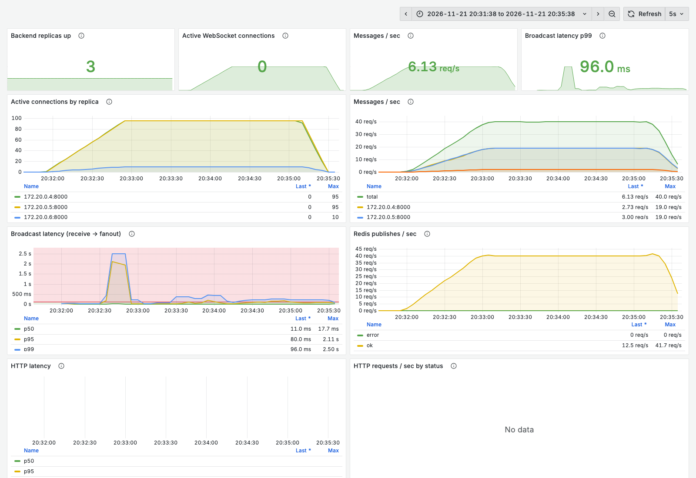
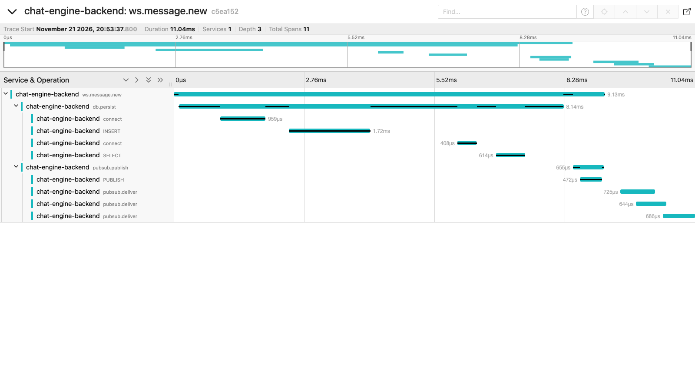

# chat-engine

A production-grade real-time chat platform with WebSocket messaging, horizontal scaling via Redis Pub/Sub, and an AI layer for semantic search and RAG-powered assistant responses.

> **Built agent-first.** Every piece of context an AI coding agent needs is committed to the repo. See `AGENTS.md` for the universal spec and `docs/OPERATIONS.md` for the workflow.

## Tech stack

- **Frontend** — Next.js 15 (App Router), TypeScript strict, Tailwind v4, shadcn/ui, TanStack Query, Zustand, Auth.js
- **Backend API** — FastAPI, SQLModel, asyncpg, Alembic, structlog
- **WebSocket gateway** — FastAPI (Python) now; optional Go gateway in Epic 6
- **AI worker** — arq, OpenAI embeddings + chat completions, tenacity
- **Database** — Postgres 16 + pgvector
- **Cache / Pub-Sub / Presence** — Redis 7
- **Object storage** — Cloudflare R2 (S3 API)
- **Observability** — OpenTelemetry, Prometheus, Grafana, Sentry
- **Infra** — Docker Compose, GitHub Actions, Fly.io

See [`docs/ARCHITECTURE.md`](docs/ARCHITECTURE.md) for the target architecture.

## Quick start

```bash
git clone <repo>
cd chat-engine
cp .env.example .env
docker compose up -d postgres redis
make -C backend install
make -C frontend install
make dev                  # backend :8000, frontend :3000
```

Then open `http://localhost:3000`.

## Project layout

```
chat-engine/
├── AGENTS.md                  # Universal agent spec
├── README.md                  # You are here
├── CONTRIBUTING.md            # How to contribute (humans + agents)
├── chat-plan.md               # Original product brief (excluded from agent context)
├── .cursor/rules/             # Scoped agent rules (.mdc with YAML frontmatter)
├── .cursorignore              # Token-discipline exclusions
├── .claudeignore              # Same, mirrored for Claude clients
├── .env.example               # Canonical env-var list
├── docker-compose.yml         # Postgres + Redis (local dev)
├── Makefile                   # Top-level dev / test / lint / build
├── docs/
│   ├── ARCHITECTURE.md        # Target system design
│   ├── BACKLOG.md             # ID-anchored task list (S<epic>.<story>)
│   ├── PROGRESS.md            # Live state — read first every session
│   ├── OPERATIONS.md          # Collaborator workflow manual
│   └── CONVENTIONS.md         # Coding standards
├── backend/                   # FastAPI HTTP API + WebSocket gateway + arq worker
│   ├── AGENTS.md
│   └── src/app/...
├── frontend/                  # Next.js 15 TypeScript app
│   ├── AGENTS.md
│   └── src/...
└── infra/                     # Docker, CI, observability stack, k6 load tests
    └── AGENTS.md
```

## Where to start

**Humans:** [`CONTRIBUTING.md`](CONTRIBUTING.md) → [`docs/OPERATIONS.md`](docs/OPERATIONS.md).

**AI agents:** [`AGENTS.md`](AGENTS.md) → [`docs/PROGRESS.md`](docs/PROGRESS.md) → pick a task from [`docs/BACKLOG.md`](docs/BACKLOG.md). The `.cursor/rules/` directory auto-attaches the right context based on the files you edit.

**Reviewers:** [PR checklist](docs/OPERATIONS.md#4--review).

## Commands

| Command         | What it does                                      |
| --------------- | ------------------------------------------------- |
| `make dev`      | Start backend (:8000) + frontend (:3000) in parallel |
| `make test`     | Run backend + frontend tests                       |
| `make lint`     | Lint backend + frontend                            |
| `make build`    | Build the frontend                                 |
| `make -C backend <target>` | See `backend/AGENTS.md`                 |
| `make -C frontend <target>`| See `frontend/AGENTS.md`                |

## Benchmarks

k6 WebSocket flood through nginx to **3 backend replicas** sharing Redis Pub/Sub and Postgres, run on one laptop (Docker Desktop for Mac, 8 CPU / 4 GB VM). Rooms of 10 users, each sending one message every 5s.

| Concurrent sockets | Messages | Lost | Sender echo p50 / p95 / p99 | Delivery to others p50 / p95 / p99 |
| ------------------ | -------- | ---- | --------------------------- | ---------------------------------- |
| **200** | 6,981 sent → 62,556 deliveries | **0** | 9 / 109 / 749 ms | 8 / 105 / 489 ms |
| 500 | 17,270 sent → 154,988 deliveries | 1,918 not echoed within 5s | 19 ms / 3.4 s / 4.8 s | 75 ms / 8.8 s / 14.2 s |

200 sockets is the most this setup sustains: no messages lost, median under 10 ms, but the p99 misses the 100 ms target. Known causes are event-loop stalls in the backend (not profiled yet), Docker Desktop VM jitter, and nginx placing sockets unevenly (95/95/10). Details: [`docs/SPRINT.md`](docs/SPRINT.md) (T5).



One message traced across all 3 replicas in Jaeger (send on one, delivery on each):



Reproduce: `make load-test VUS=200 RAMP=1m HOLD=2m SESSION_S=600 RUN_NAME=200vu-3r`. Reports: [`docs/benchmarks/`](docs/benchmarks/).

## Status

See [`docs/PROGRESS.md`](docs/PROGRESS.md) for the live status of every story.

## License

MIT — see [`LICENSE`](LICENSE).
