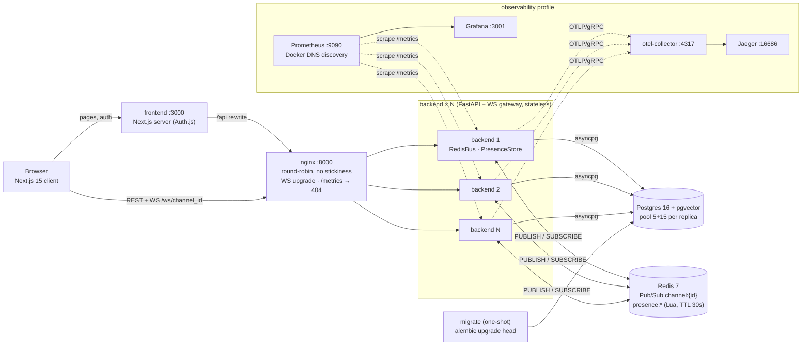
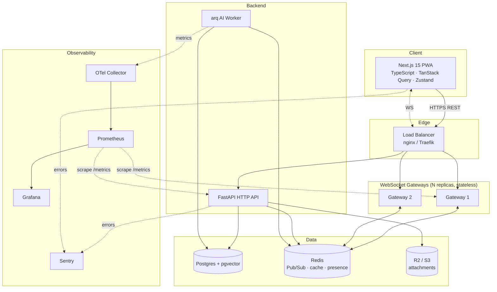
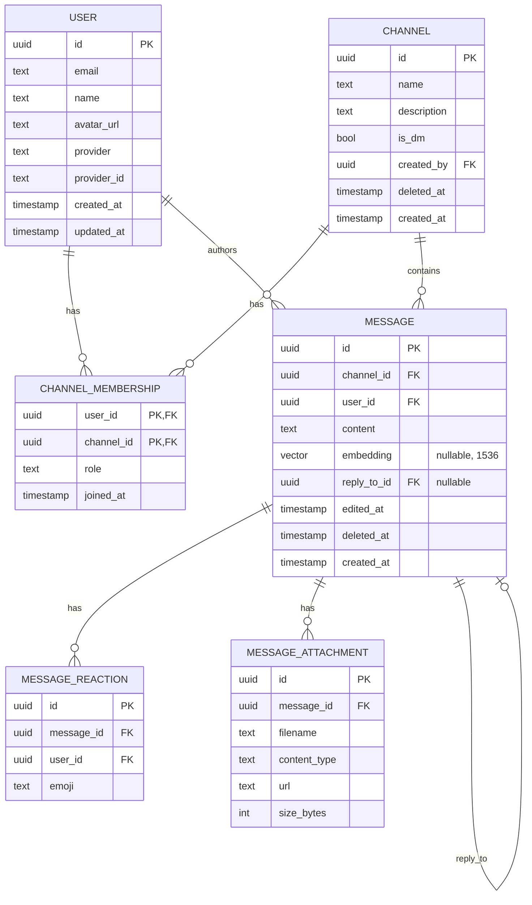
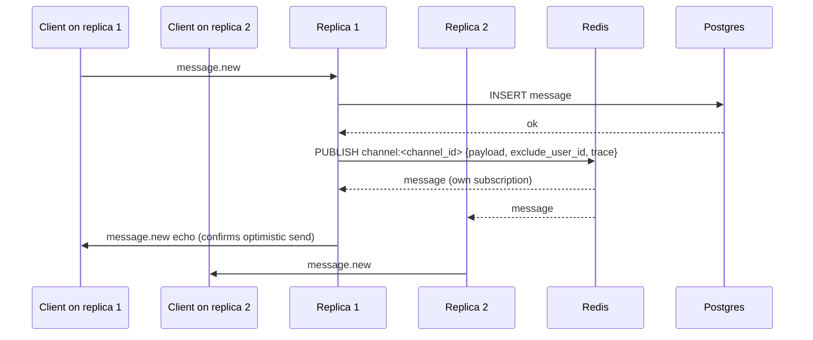
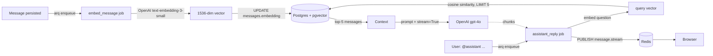

# ARCHITECTURE — chat-engine

> Target architecture (what we are building toward, per `chat-plan.md`). Sections marked **planned** are not yet implemented; see `docs/PROGRESS.md` for live state.

---

## As built (2026-11-21)

What `docker compose up --scale backend=3` runs today. Dashed boxes are under `--profile observability`.



- A message sent on any replica is inserted into Postgres, published once to `channel:{id}`, and delivered by every replica that holds a socket in that channel (`S6.1`). One trace covers the send and every delivering replica (`S7.2`).
- Presence and gap fill keep clients in sync across replicas and reconnects (`S4.2`, `S4.3`).
- Not built yet: AI worker (Epic 5), R2 uploads (`S8.3`), Sentry (`S7.4`), Go gateway (`S6.2`), read replica / Redis cache (`S6.5`).

## Target system overview



"Gateway" and "API" are the same Python process, and any number of them can run side by side (`S6.1`). Each instance runs one `RedisBus` (`services/pubsub.py`): handlers only `publish()` to Redis topic `channel:{id}`, and each instance subscribes to a channel's topic while it holds at least one local socket in that channel, delivering what it receives to those sockets. The sender's own instance also delivers from Redis, so there is exactly one delivery path. If publishing fails, the event is delivered locally (single-instance degraded mode). The envelope is `{"payload", "exclude_user_id", "trace"?}`; `trace` carries the OpenTelemetry context (`S7.2`). Delivery is at-most-once (Pub/Sub); clients recover gaps with `S4.3`.

**Reconnect gap fill (`S4.3`).** `WebSocketContext` exposes `status` (`connecting` / `open` / `reconnecting`) and `reconnectCount`. On each reconnect, `useMessages` asks for `GET /api/channels/{id}/messages?after=<newest confirmed id>&limit=200`, merges the result into the newest page and dedupes by id (live messages on the new socket may already be there). If `has_more` is true (gap > 200) or the cursor is unknown (400), it drops the cache and reloads the newest page. A banner shows "Reconnecting…" while the socket is down and "Reconnected — catching up…" during the fill. Edits and deletes made during the gap are not recovered (no event log); they show on the next full load.

---

## Component responsibilities

| Component         | Responsibility                                                                    | Stack                                 |
| ----------------- | --------------------------------------------------------------------------------- | ------------------------------------- |
| Browser (PWA)     | UI, optimistic updates, offline cache, push notifications                         | Next.js 15, TS, shadcn, TanStack Query|
| HTTP API          | REST reads (channels, messages history, search, auth sync, uploads), admin ops    | FastAPI, asyncpg, SQLModel            |
| WebSocket Gateway | Stateless WS termination, JWT validation, Redis pub/sub fan-out                   | FastAPI now → Go later (`S6.2`)       |
| AI Worker         | Embedding generation, `@assistant` RAG, summarization, daily digest               | arq, OpenAI, tenacity                 |
| Postgres          | Source of truth: users, channels, memberships, messages (+ vector embeddings), reactions, attachments, notifications | Postgres 16 + pgvector. Per-instance pool 5 + 15 overflow (`DB_POOL_SIZE`, `DB_MAX_OVERFLOW`), so N instances use up to 20·N connections; keep under `max_connections` (100) |
| Redis             | Pub/Sub broadcast, sliding-window rate limit, presence TTL keys, query embedding cache, hot-read cache | Redis 7 |
| R2 / S3           | Attachment storage; clients PUT via pre-signed URLs                               | Cloudflare R2 (S3 API)                |

---

## Data model (current)



Tables added later: `notifications` (`S8.4`), `banned_users`, `pinned_messages`, `moderation_log` (`S8.6`), `poll_options`, `poll_votes` (`S8.5`).

---

## WebSocket protocol

All messages are JSON: `{ "type": <WSMessageType>, "payload": <object> }`.

| Type                | Direction        | Payload                                                            |
| ------------------- | ---------------- | ------------------------------------------------------------------ |
| `message.new`       | client ↔ server  | in: `{ content, reply_to_id? }` · out: message + `server_ts` (epoch ms received) |
| `message.edit`      | client ↔ server  | `{ message_id, content }`                                          |
| `message.delete`    | client ↔ server  | `{ message_id }`                                                   |
| `message.reaction`  | client ↔ server  | `{ message_id, emoji }`                                            |
| `message.stream`    | server → client  | `{ message_id, chunk, done }` (assistant streaming)                |
| `typing.start`      | client ↔ server  | `{ user_id, channel_id }`                                          |
| `typing.stop`       | client ↔ server  | `{ user_id, channel_id }`                                          |
| `presence.join`     | server → client  | `{ user_id, channel_id }`                                          |
| `presence.leave`    | server → client  | `{ user_id, channel_id }`                                          |
| `presence.snapshot` | server → client  | `{ channel_id, online_user_ids: [...] }`, once per new socket, sender included |
| `ping`              | client → server  | `{}` every 20s; no reply (any inbound frame refreshes presence)    |
| `notification.new`  | server → client  | `{ notification_id, type, message_id }`                            |
| `error`             | server → client  | `{ message }`                                                      |

Connection URL: `WS /ws/{channel_id}?token=<jwt>`. Server **must** authenticate and authorize before `ws.accept()`. Auth failure closes with code `4001`.

## Presence (`S4.2`)

Presence state lives in Redis, so all replicas agree on it.

| Key | Type | Content |
| --- | ---- | ------- |
| `presence:channel:{channel_id}` | sorted set | One member per open socket, `"{user_id}:{conn_id}"`, score = expiry (epoch ms, Redis `TIME`). Key `PEXPIRE` 4×TTL as a last-resort cleanup. |
| `presence:{user_id}` | string, `PX` TTL | "Online anywhere" flag, refreshed with the set. Nothing reads it yet. |
| `presence:channels` | set | Channel ids that have members, iterated by the sweeper. |

- **TTL 30s** (`PRESENCE_TTL_SECONDS`). Any inbound frame refreshes the socket's entry, at most once per TTL/3 per socket. The client sends `ping` every 20s.
- **Join/leave are per user, not per socket.** `presence.join` goes out only when a user's first live socket in the channel appears, and `presence.leave` only when the last one goes, so two tabs on two replicas produce one join and one leave.
- **Expiry.** Every replica sweeps every 5s (`PRESENCE_SWEEP_INTERVAL_SECONDS`) and publishes `presence.leave` for users whose last entry expired. That covers sockets that went silent and replicas that died. A silent socket that speaks again rejoins (`presence.join`).
- **Exactly once.** Touch, leave, sweep and snapshot are Lua scripts, so concurrent replicas can't both report the same transition. They use Redis `TIME`, so replica clock skew doesn't matter. The scripts touch keys of different hash slots, so this assumes a single Redis, not Cluster.
- **Redis down.** Join/leave fall back to "always announce" (the behaviour before S4.2) and the snapshot contains only the connecting user.

---

## Metrics (`S7.3`)

Every backend replica serves its own `/metrics` (one uvicorn process per container, so no `PROMETHEUS_MULTIPROC_DIR`). Prometheus finds replicas through Docker DNS (`dns_sd_configs` on `backend`), so `--scale` needs no config change. nginx returns 404 for `/metrics`; it is only reachable on the compose network.

| Metric | Type | Meaning |
| ------ | ---- | ------- |
| `ws_active_connections` | Gauge | Sockets held by this replica (read from `ConnectionManager` at scrape time) |
| `messages_broadcast_total` | Counter | `message.new` accepted, counted once on the receiving replica |
| `redis_pubsub_publish_total{result}` | Counter | Redis PUBLISH calls; `error` = local-only fallback |
| `message_broadcast_latency_seconds` | Histogram | `server_ts` (handler start) → send to every local socket returned, observed on each delivering replica, so it includes DB insert, Redis hop and fanout |
| `http_requests_total`, `http_request_duration_seconds`, `http_request_duration_highr_seconds` | Counter / Histogram | `prometheus-fastapi-instrumentator`; `/metrics`, `/health`, `/ready` excluded |

`server_ts` is wall-clock time, so the cross-replica latency assumes the hosts' clocks agree (true on one Docker host; needs NTP across machines). Negative values are clamped to 0. Dashboard: `infra/grafana/dashboards/overview.json`.

## Tracing (`S7.2`)

`app/telemetry.py` turns tracing on only when `OTEL_EXPORTER_OTLP_ENDPOINT` is set (tests force it blank). Path: backend → OTLP/gRPC → `otel-collector` (:4317) → Jaeger (UI :16686), both under `--profile observability`. Spans carry `service.name=chat-engine-backend` and `service.instance.id=<container hostname>`. Sampling uses the standard `OTEL_TRACES_SAMPLER` variables (default: every trace).

- **Auto-instrumented:** FastAPI HTTP routes (`/health`, `/ready`, `/metrics` excluded), SQLAlchemy/asyncpg queries, Redis commands. The pub/sub listener's polling is not a command, so it creates no spans.
- **WebSockets:** the socket itself is not a span. One span would stay open for the whole connection and put every message into one trace. Instead `ws.connect` (auth + register + presence join) and `ws.message.new` each start a new trace.
- **`message.new` trace:** `ws.message.new` → `db.persist` (→ `INSERT`, `SELECT`) and `pubsub.publish` (PRODUCER, → `PUBLISH`). `publish()` adds the W3C context to the Redis envelope as `"trace": {"traceparent": ...}`, and every delivering replica opens `pubsub.deliver` (CONSUMER, attribute `chat.local_recipients`) under it. One trace therefore shows the send on replica A and the fanout on replicas A..N. Events published outside a span (typing, presence leave) carry no context and produce no spans. Envelopes without (or with a bad) `trace` still deliver.
- The load-test overlay disables tracing so k6 runs stay comparable with the T5 baseline.

---

## WebSocket scaling (`S6.1`)



Each replica keeps a refcount of local sockets per channel. When the first local socket joins, it subscribes to `channel:<channel_id>`; when the last leaves, it unsubscribes. The sender's replica also delivers from its own subscription, so there is one delivery path. Any replica can serve any user, so nginx round-robins with no sticky sessions.

## Measured performance (`S6.4`, 2026-11-21)

k6 WebSocket flood (`make load-test`) through nginx over 3 replicas on one laptop (Docker Desktop for Mac, 8 CPU / 4 GB VM). Rooms of 10, one message per VU every 5s, tracing and stdout logging off. Full table and findings: `docs/SPRINT.md` T5; reports in `docs/benchmarks/`.

| Concurrent sockets | Messages | Lost | Send → own echo p50 / p95 / p99 | Send → other members p50 / p95 / p99 |
| ------------------ | -------- | ---- | ------------------------------- | ------------------------------------ |
| **200** (max sustainable) | 6,981 sent, 62,556 deliveries | 0 | 9 / 109 / 749 ms | 8 / 105 / 489 ms |
| 500 | 17,270 sent, 154,988 deliveries | 1,918 no echo within 5s (late + lost; older script did not separate them) | 19 ms / 3.42 s / 4.84 s | 75 ms / 8.77 s / 14.2 s |

The 100 ms p99 target is not met on this machine. Known causes: event-loop stalls in the backend (not yet profiled), Docker Desktop VM jitter (an idle asyncio loop stalled up to 435 ms), and uneven placement by nginx (95/95/10 sockets). nginx's `worker_connections` caps the setup at about 4k sockets.

---

## AI pipeline (planned — Epic 5)



---

## Engineering decisions

| Decision                              | Choice                              | Why                                                                                                                            |
| ------------------------------------- | ----------------------------------- | ------------------------------------------------------------------------------------------------------------------------------ |
| Vector store                          | **pgvector** (extension on Postgres)| Single source of truth; no second system to operate; performance is adequate up to tens of millions of vectors.                |
| Background work                       | **arq**                             | Async-native (no thread overhead like Celery), small surface area, Redis-backed (we already run Redis).                       |
| WebSocket auth                        | **JWT in `?token=` query param**    | Cookies aren't always sent on cross-origin WS upgrades; first-message auth adds a round trip; query param works everywhere with HTTPS. |
| Session storage                       | **JWT only**, no DB session table   | Stateless backend; gateway can validate without a DB hit; refresh handled by NextAuth.                                         |
| Gateway language                      | **Python now, Go later (`S6.2`)**   | Python is enough until ~10K connections; Go gives 10× density per node when needed.                                            |
| Pagination                            | **Cursor (`?before=` / `?after=<message id>`), ordered by `(created_at, id)`** | Stable under concurrent writes; offset pagination shifts rows when new messages arrive. Ids are random uuid4, so the cursor id is resolved to its `(created_at, id)` position and compared as a row (`id` breaks ties). Index `ix_messages_channel_id_created_at_id_live (channel_id, created_at, id) WHERE deleted_at IS NULL` serves both directions with no sort. Known limit: `created_at` is set in the app before commit, so a message from a slow transaction can commit with a `created_at` older than one already delivered, and an `after=` fill can miss it (window ≈ commit latency). |
| Frontend state                        | **TanStack Query + Zustand**        | TQ for server state with optimistic updates + cache; Zustand for tiny client-only stores (no Redux ceremony).                  |
| Soft delete                           | **`deleted_at` column**             | Preserves audit trail and lets us undo accidental deletes; reads always filter `deleted_at IS NULL`.                           |
| Migrations                            | **Alembic, async, append-only**     | Standard for SQLAlchemy; never edit a merged revision (creates merge-conflict landmines).                                      |
| Real-time scaling                     | **Redis Pub/Sub fan-out**           | Stateless gateways behind round-robin LB; no sticky sessions; trivial horizontal scale.                                        |
| File uploads                          | **Pre-signed PUT to R2**            | Files never traverse our servers; R2 has no egress fees.                                                                       |

---

## Non-functional targets

| Property                          | Target                                | Measured (2026-11-21, 3 replicas, laptop) |
| --------------------------------- | ------------------------------------- | ----------------------------------------- |
| P50 broadcast latency             | <50 ms                                | 8 ms at 200 sockets                       |
| P99 broadcast latency             | <200 ms                               | 489 ms at 200 sockets (missed)            |
| Concurrent WS connections (Py)    | 10K (single replica)                  | 200 sustained over 3 replicas; degrades from 500 |
| Concurrent WS connections (Go)    | 100K (single replica) — `S6.2`        |
| Test coverage (backend)           | ≥70% lines                            |
| CI wall time                      | <5 minutes                            |
| Postgres write IOPS               | <500 sustained                        |
| Sentry trace sample rate          | 20% (prod)                            |

These are tracked in Grafana (`S7.3`) and validated by k6 (`S6.4`).

---

## Local environment

`docker-compose.yml` runs the full stack — Postgres, Redis, backend (FastAPI + Alembic migrations on startup), and frontend (Next.js dev server). A single `docker compose up` is all that is needed.

```
docker compose up
```

Services start in dependency order: Postgres & Redis first (healthchecked), then backend (runs `alembic upgrade head` before starting uvicorn with `--reload`), then frontend (`next dev` with source code bind-mounted for hot reload).

Alternatively, run only infrastructure in Docker and the application services on the host for a lighter dev loop:

```bash
docker compose up -d postgres redis
make -C backend install && make dev-backend
make -C frontend install && make dev-frontend
```

Dockerfiles live at `backend/Dockerfile` and `frontend/Dockerfile` (multi-stage, non-root runtime user).

Optional `--profile observability` brings up Prometheus (:9090), Grafana (:3001, overview dashboard as home, anonymous read-only), the OTel collector (:4317) and Jaeger (:16686). Traces are exported only when `.env` sets `OTEL_EXPORTER_OTLP_ENDPOINT` (any value; compose points the backends at `otel-collector`).

Port reservations are listed in `infra/AGENTS.md`.
